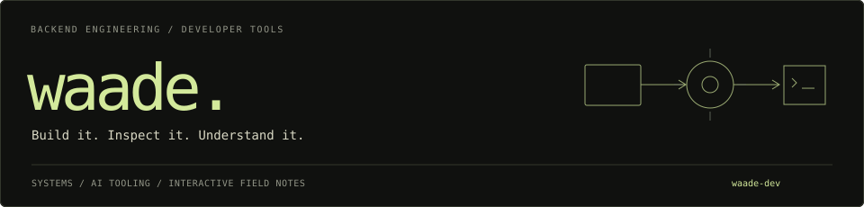

I'm a backend engineer building developer tools and interactive guides to how software systems work.

My work spans debugging, AI tooling, observability, and the infrastructure behind agents. I use small implementations and explorable examples to make technical ideas concrete.

**[Explore my projects →](https://waade-projects.vercel.app/)**

## Selected work

| Project | What you can explore |
| --- | --- |
| [Sazabi — Under the Hood](https://sazabi-field-guide.vercel.app/) | AI observability from signal collection to investigation: architecture, incident simulations, system requirements, and a replication blueprint. |
| [POLYLUME](https://www.rechargecompare.in/) | A visual workspace for system diagrams, flows, wireframes, and ideas. |
| [Inside SPACE](https://inside-space.rechargecompare.in/) | An interactive guide to agent sandboxes, command execution, and runtime lifecycle. |
| [Second Brain](https://second-brain-obsedian-notion-library.rechargecompare.in/) | A personal research library and Kanban board connected to Notion. |
| [Interactive Paper Library](https://reasearch-paper-impl.rechargecompare.in/) | AI papers explained through animated architectures and interactive articles. |

## Engineering interests

- **Backend systems:** service boundaries, debugging, failure behavior, and production visibility.
- **AI developer tools:** coding-agent workflows, sandbox execution, and useful context for investigations.
- **Technical explanations:** diagrams, simulations, and field guides grounded in implementation details.

## Public code

- [waade-projects](https://github.com/waade-dev/waade-projects) — the project explorer behind the collection.
- [second-brain-obsedian](https://github.com/waade-dev/second-brain-obsedian) — the library and Notion integration project.
- [code-assistant](https://github.com/waade-dev/code-assistant) — an experiment in building a coding assistant from scratch.

---

[waade / projects](https://waade-projects.vercel.app/) · Build to learn. Write to understand.
